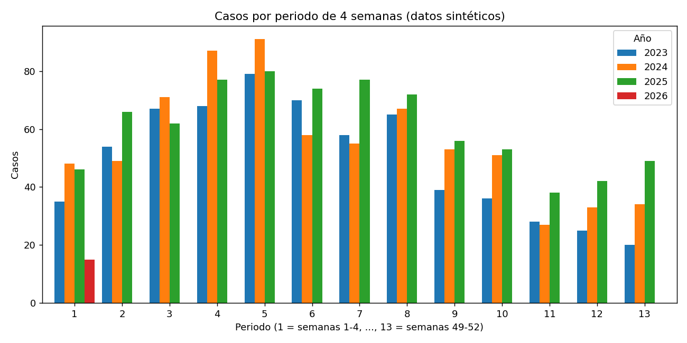

# Pipeline de procesamiento de datos de vigilancia epidemiológica

Proyecto en **Python** que automatiza el procesamiento semanal de archivos de notificación de eventos de salud pública (con la estructura de los archivos del **Sivigila**): limpia los datos, traduce códigos, asigna coordenadas a cada caso, evita duplicados y deja una base lista para cargarse en **BigQuery** y visualizarse en **Looker Studio**.

> ⚠️ **Todos los datos de este repositorio son sintéticos.** Municipios, veredas, coordenadas e identificadores son ficticios y se generan con `scripts/generar_datos_demo.py`. No hay información de personas ni de instituciones.

## 🎯 Problema
Los archivos de notificación llegan crudos: códigos numéricos sin significado, nombres de lugares escritos de formas distintas, sin coordenadas y con casos repetidos de una semana a otra. Limpiarlos a mano cada semana consume tiempo y genera errores.

## ⚙️ Flujo de trabajo
1. **Lectura** del archivo semanal (`.csv` o `.xlsx`).
2. **Filtrado** del territorio de interés.
3. **Traducción de códigos** a categorías legibles (zona, sexo, pertenencia étnica, tipo de caso, origen, especie) con diccionarios.
4. **Variables derivadas:** grupo de edad, indicador de menor de 10 años y periodo de 4 semanas epidemiológicas.
5. **Georreferenciación:** cruce con un catálogo de veredas y barrios (primero por vereda, luego por barrio). Los lugares que no encuentra quedan en un archivo de pendientes.
6. **Detección de duplicados** con una llave (caso + semana + año): solo se agregan los casos nuevos a la base maestra.
7. **Exportación** de una base maestra en CSV, lista para BigQuery y Looker Studio.

## 🔒 Decisiones de diseño
- **No se procesan datos de identificación:** el caso se identifica con un código anónimo y el flujo no incluye documento ni dirección.
- **Reprocesar un archivo no duplica casos:** la base maestra solo crece con casos nuevos.

## ▶️ Cómo ejecutarlo
```bash
pip install -r requirements.txt

# 1. Generar datos sintéticos
python scripts/generar_datos_demo.py

# 2. Procesar el histórico
python scripts/procesar_vigilancia.py data/notificacion_demo.csv

# 3. Procesar una semana nueva (incluye casos repetidos)
python scripts/procesar_vigilancia.py data/notificacion_demo_semana_nueva.csv

# 4. Generar resumen y gráfico
python scripts/resumen_resultados.py
```

## ✅ Verificación del flujo
| Ejecución | Filas en el archivo | Duplicados detectados | Casos agregados | Base maestra |
|---|---|---|---|---|
| Histórico | 2.160 | 0 | 2.160 | 2.160 |
| Semana nueva (30 repetidos + 15 nuevos) | 45 | 30 | 15 | 2.175 |
| Misma semana otra vez | 45 | 45 | 0 | 2.175 |

## 📊 Resultados de la demostración (datos sintéticos)
| Año | 2023 | 2024 | 2025 | 2026 (1 semana) |
|---|---|---|---|---|
| Casos | 644 | 724 | 792 | 15 |
| Menores de 10 años | 132 | 146 | 150 | 5 |



## 🧰 Herramientas
Python (pandas, matplotlib) · CSV · listo para Google BigQuery y Looker Studio

## 📁 Estructura
| Ruta | Contenido |
|---|---|
| `scripts/generar_datos_demo.py` | Genera datos y catálogo sintéticos |
| `scripts/procesar_vigilancia.py` | Pipeline de procesamiento |
| `scripts/resumen_resultados.py` | Resumen por año y gráfico |
| `data/` | Archivos sintéticos de entrada y catálogo de lugares ficticio |
| `resultados/` | Gráfico y resumen generados |
